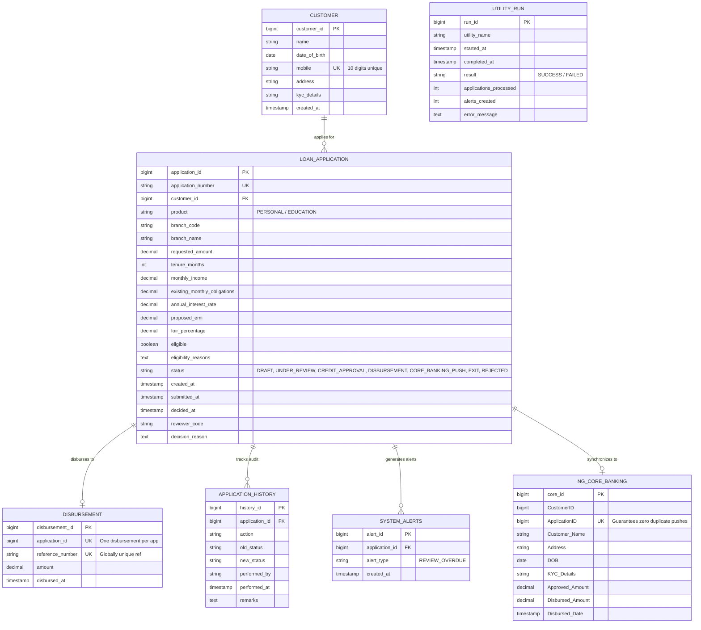

# Entity-Relationship (ER) Diagram
## MINI LOAN ORIGINATION SYSTEM (LOS)

The database consists of **7 logical tables** designed to support end-to-end loan workflows, ACID audit logging, idempotent background alert tracking, and Core Banking synchronization.

---

### Mermaid ER Diagram

---

### Key Database Constraints & Design Highlights:
1. **Disbursement Integrity:**
   * `disbursement.application_id` has a `UNIQUE` constraint, enforcing at the database level that an application can never be disbursed more than once.
   * `disbursement.reference_number` has a `UNIQUE` constraint, ensuring globally unique payment references.
2. **Idempotent Alerts:**
   * `system_alerts` enforces a `UNIQUE (application_id, alert_type)` constraint, guaranteeing that repeated runs of the overdue utility will never generate duplicate alerts.
3. **Core Banking Synchronization:**
   * `ng_core_banking.ApplicationID` has a `UNIQUE` constraint, guaranteeing zero duplicate entries in the Core Banking table.
4. **Validation Constraints:**
   * `CHECK (CHAR_LENGTH(mobile) = 10)` enforces valid mobile numbers.
   * `CHECK (monthly_income > 0)` and `CHECK (existing_monthly_obligations >= 0)` enforce financial integrity.
